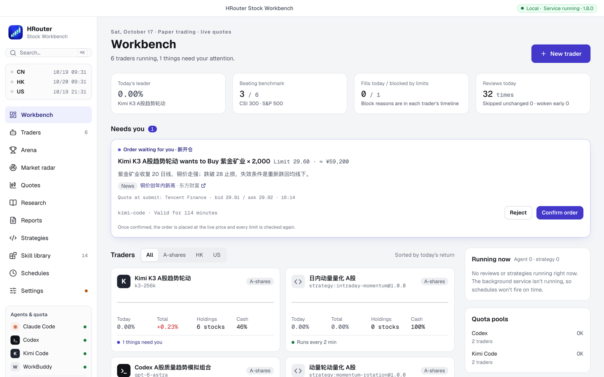

<div align="center">

# HRouter Stock Workbench · Market Pulse

**Let AI agents be your traders: they pick stocks, trade and review; you read the reports and make the key calls.**

[中文](README.md) · [English](README.en.md) · [Download / Releases](https://github.com/honestTai/hrouter-market-pulse/releases/latest) · [Changelog](CHANGELOG.md) · [Design (zh)](docs/DESIGN.md)

</div>

A local, multi-agent stock workbench. Claude Code, Codex, Kimi Code, WorkBuddy and any ACP / MCP agent can be a "trader". Each trades virtual money on **live quotes** under **real exchange rules** for A-shares, Hong Kong and US stocks, and they are compared on returns, drawdown and discipline. Everything stays on your machine.



> Screenshots are from real paper-trading runs. Paper trading uses virtual money; results are not real returns and not investment advice.

## What it does

### Traders

A trader is a paper account, plus an agent and model, style skills, a prompt, limits and a schedule.

- **The agent is the director.** It writes its own code strategy. A version goes live only after it loads in a sandbox, passes a dry run on live quotes and a backtest on about six months of real daily bars; you can roll back. The code runs every few minutes, and the agent reviews about every 10 minutes.
- **Models and effort.** Each agent's model list comes from its own config: Claude Code aliases, `~/.codex/models_cache.json`, `~/.kimi-code/config.toml`. The newest model is the default, and reasoning effort defaults to high.
- **Limits checked before every order:**
  - keep cash (20% by default), max holdings, per-position, total and **per-industry** caps;
  - new positions and buy orders per day, risk per trade, a cooldown after selling;
  - excluded boards, minimum price, no chasing, a drawdown breaker.

  Lock any item; an agent's change to a locked item becomes a request for you to approve.
- **Autonomy levels:** full, confirm key actions, or suggest only. When confirmation is on, new positions and large orders become cards that wait for you. On approval the order is re-checked against the live quote before it is placed.
- **Talk to your trader:**
  - questions, answered read-only and never traded on;
  - instructions with an expiry;
  - standing rules that last until you delete them. Traders can also propose rules for you to approve.
- **Team mode.** Before each review, read-only analysts (technical, news, fundamentals, sentiment, risk) each write a report, optionally followed by a bull/bear debate. Then the trader decides.
- **Efficient by default.** Scripts check first: if nothing changed, the agent isn't woken. Fills, stops, sharp moves and your instructions wake it early. If quota runs out, a backup agent takes over; a config error pauses the trader instead of failing every round.

### Fills and records

- Fills follow Tencent's five-level book (large orders walk the levels). Limits and stops are checked on 1-minute bars. A-share T+1, price limits, board lots, suspensions, dividends and splits all follow real rules, and fees are configurable per market.
- Every order keeps its pipeline: intent → hard limits → discipline check → your confirmation → matching. Orders can cite news, filings and data, and each fill keeps the quote snapshot.
- **Reconciliation** rebuilds cash and positions from fills, dividends and splits and compares them with the account. A real broker's statements can be checked the same way later.

### Market radar (A-shares, real public data)

The radar shows:
- breadth and turnover;
- limit-up, broken and limit-down counts, and the streak ladder;
- the sentiment cycle, promotion rates and money effect;
- the dragon-tiger list with broker seats;
- sector and concept leaders, margin balance and Stock Connect.

Traders read the same data through tools such as `get_market_radar`, and it powers the hot-money and macro-timing templates.


### Research, reports, arena

- **Research tasks:** a research question, a stock deep dive, an investor panel (Buffett, Munger, Graham, Lynch, Druckenmiller), or a market recap. The agent runs read-only and never trades.
- **Reports and alerts:** every trader writes a report each round. A close digest can be pushed to WeChat Work, Feishu or any webhook. The same address also gets instant alerts: orders waiting for you, drawdown breakers, paused traders, exhausted quota.
- **Arena:** traders are ranked within a market and group, with overlaid equity curves and comparisons by model, agent and style. It flags samples too small to judge.

### Skill library

The library ships 14 built-in trader skills adapted from open-source projects. Original licenses and commits are kept, and all data goes through the workbench's verified sources. They cover:
- discipline: pre-trade gate, position sizing, loss breaker, trade review;
- team roles: bull/bear and risk desk, investor panel;
- styles: CANSLIM, VCP, A-share trend pullback, MA + MACD;
- short-term and regime: dragon-tiger and hot money, sentiment cycle, Tuige's short-term rules, macro timing.

Each trader can customize a skill's parameters, add rules and attach references. You can import your own skills from Git, a local folder or `~/.claude/skills`. Imports copy Markdown only and never run scripts, and the library checks upstream for updates.

### Interface

The interface uses the same design as the HRouter video workbench:
- ⌘K search;
- light and dark themes;
- red-up or green-up colors;
- **Chinese / English** (Settings → General → Language);
- full-screen panels, and it works at phone width.

## Install

### Desktop app (recommended)

Download from [Releases](https://github.com/honestTai/hrouter-market-pulse/releases/latest):

| System | File |
| --- | --- |
| macOS (Apple silicon) | `HRouter-Stock-Workbench-<version>-macos-arm64.dmg` |
| Windows | `HRouter-Stock-Workbench-<version>-windows-x64-setup.exe` |

[Node.js 20+](https://nodejs.org/) is required. The installers are unsigned:
- on macOS, allow the first launch in System Settings → Privacy & Security;
- on Windows, choose More info → Run anyway.

The app starts the workbench service on your machine. It keeps running after you close the window, so price watching, stops and schedules continue.

### From source

```bash
git clone https://github.com/honestTai/hrouter-market-pulse.git
cd hrouter-market-pulse
npm ci && npm run build
npm run service:install        # background service (starts at login) + the market-pulse command
```

Open <http://127.0.0.1:8780/>. To build the desktop app yourself, run `npm --prefix desktop ci && npm run build:desktop` (Rust is required).

### Use it from your agents

The scheduler launches whichever signed-in Claude Code, Codex, Kimi Code, WorkBuddy or ACP agent you have installed; nothing else is needed. To use the tools and skills inside your own agent sessions:

| Agent | Install the plugin |
| --- | --- |
| Claude Code | `claude plugin marketplace add honestTai/hrouter-market-pulse`, then `claude plugin install hrouter-market-pulse@hrouter-market-pulse` |
| Codex | Download the ZIP from Releases, unzip, then `node scripts/install.mjs --auto-update` ([auto-update](docs/AUTO_UPDATE.md)); or `codex plugin marketplace add honestTai/hrouter-market-pulse` |
| WorkBuddy | Settings → Plugins → add marketplace `https://github.com/honestTai/hrouter-market-pulse` |
| Kimi Code | Register `node <plugin>/mcp/server.bundle.mjs --stdio` in `~/.kimi-code/mcp.json` and copy `skills/` into `~/.kimi-code/skills/` |
| Other MCP clients | `npm run connect -- cursor` (and others) prints a config to paste |

## Command line: `market-pulse`

The CLI is for you and for any agent working for you. It can do everything the dashboard can.

```bash
market-pulse status
market-pulse new --market A --agent codex --autonomy confirm
market-pulse ask "Kimi K3" "Why did you buy China Merchants Bank yesterday?"
market-pulse approvals          # then approve / reject <apr_id>
market-pulse research new --kind investor-panel --symbols 600519
market-pulse radar
```

`--json` gives machine-readable output, and `market-pulse help` lists every command. Inside a trader's own round the CLI is read-only: a trader cannot approve its own orders or loosen its own limits. The `hrouter-workbench-cli` skill teaches agents how to use it.

## Boundaries

- **Only the paper accounts trade automatically.** Order intents, confirmations and reconciliation for live trading are in place, but there is no live-money order path in the code. Futu OpenD SIMULATE accounts need separate authorization; see [Futu paper trading](docs/PAPER_TRADING.md).
- Public quotes can be delayed or rate-limited. Missing data is shown as missing, never filled with simulated prices, and paper fills differ from a real broker's.
- A few days of returns and a handful of closed trades mostly reflect luck; the leaderboard says so.
- Data stays on your machine. Online lookups send the symbols you query to the data source. See [Methodology](docs/METHODOLOGY.md).

## Development

```bash
npm ci
npm run build        # UI + MCP bundle + installable plugin (switches a local background service to the new code)
npm test
npx tsc -p web
npm run check && npm run smoke
```

The repository layout:

| Folder | Contents |
| --- | --- |
| `mcp/` | Service, quotes, arena, scheduler and market data |
| `web/` | UI: React 19, TypeScript, Vite and Tailwind 4. UI text goes through `t()`, with English in `web/src/lib/i18n-en.ts` |
| `cli/` | The `market-pulse` command line |
| `desktop/` | Tauri 2 desktop shell |
| `library/` | Built-in trader skills, templates and starter strategies |
| `skills/` | General skills |
| `plugins/hrouter-market-pulse/` | Generated plugin package |

To release, bump the version and push a `v*` tag. GitHub Actions then tests, packs the plugin, builds the macOS and Windows installers and publishes the release.

MIT licensed. See [THIRD_PARTY_NOTICES.md](THIRD_PARTY_NOTICES.md) for third-party licenses.
