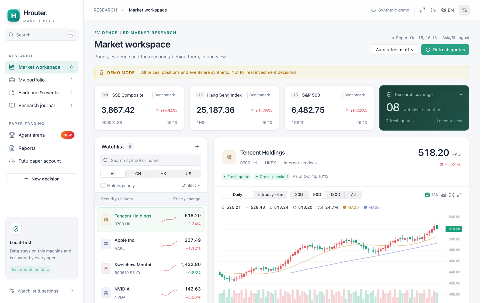

<div align="center">

# HRouter Market Pulse

**Your quotes, filings, and research notes—in one workspace.**

[中文](README.md) · [English](README.en.md) · [Plugin releases](https://github.com/honestTai/hrouter-market-pulse/releases) · [GitHub](https://github.com/honestTai/hrouter-market-pulse) · [HRouter](https://hrouter.net/home)

</div>

Go beyond a price table: review holdings, cross-check quotes, follow alerts and filings, and keep a record of your reasoning.

**Who it’s for:** Researchers who want verifiable data and AI-assisted workflows for mainland China, Hong Kong, and US equities.

The plugin uses the model of whichever agent runs it (**Codex, Claude Code, WorkBuddy** or any MCP client); no separate model service is required. The built-in **Agent Arena** lets different agents and models paper-trade side by side on real quotes with virtual money, compared on return, drawdown and discipline.



## Features

- Persistent Chinese / English interface, searchable and sortable watchlists, holdings filters, daily and five-minute charts, volume and explicit indicator periods.
- Cross-source quote checks with session-aware freshness, historical sample requirements, and stateful alert transitions.
- Benchmark comparisons, watchlist sector groups, clearly scoped breadth, original-source evidence and announced event dates.
- Currency-aware position budgets with dated FX inputs, existing holdings, shared cash and aggregate risk constraints.
- Shared-capital backtests with holding restrictions, costs, adverse slippage, nonfills and company-action handling.
- Purged walk-forward prediction evaluation, baseline comparisons, programmatic qualification, and an immutable forecast ledger.
- Decision theses recorded before outcomes, followed by append-only reviews.
- Agent Arena: one virtual A-share / HK / US account per agent, fills with T+1, price limits, board lots and fees, overlaid return curves, by-model and by-agent comparison, leaderboard and decision journals. [Guide](docs/AGENT_ARENA.md)

## Run it for real: unattended agent / quant paper trading

```bash
npm ci && npm run build
npm run service:install        # login service: in-session matching, exits, scheduled agent or strategy rounds, daily digest
```

Then set each account's Automation (Claude Code / Codex / quant strategy, trading-day run times) and risk policy at <http://127.0.0.1:8787/?view=arena>. See the [Agent Arena guide](docs/AGENT_ARENA.md) and [strategies & execution](docs/STRATEGIES.md). Live trading only has an advice-plus-manual-confirmation hook; no real orders are ever sent automatically.

## Install in Claude Code / WorkBuddy

The same package ships a Claude-format manifest, which both Claude Code and WorkBuddy install directly:

```bash
claude plugin marketplace add honestTai/hrouter-market-pulse
claude plugin install hrouter-market-pulse@hrouter-market-pulse
```

WorkBuddy: Settings → Plugins → add the marketplace `https://github.com/honestTai/hrouter-market-pulse`, then install and enable hrouter-market-pulse. For other MCP clients (Cursor, Cline, …) run `npm run connect` to print a ready-to-paste config. See the [multi-agent and arena guide](docs/AGENT_ARENA.md).

## Install in Codex (optional automatic updates)

Requires Node.js 20+ and a Codex CLI / desktop release with plugin support.

The managed installer is available starting with **v1.2.0**; older ZIPs do not contain it.

**Recommended:** download the latest stable ZIP from [Releases](https://github.com/honestTai/hrouter-market-pulse/releases/latest), extract it, and run:

```bash
node scripts/install.mjs --auto-update
```

This explicitly opts in to a **per-user background updater**. It checks stable releases roughly every six hours, verifies packages, waits for Market Pulse processes to exit before replacing the plugin, and keeps the previous version. No system-wide installs or PATH changes. Omit `--auto-update` for manual updates. Start a new Codex task after installation or an update.

Existing marketplace users must first close old plugin tasks and run `node scripts/install.mjs --auto-update --migrate` once. See [automatic updates, disable, rollback, and release instructions](docs/AUTO_UPDATE.md).

```text
Use English. Add AAPL, MSFT, and 0700.HK to my watchlist and create an intraday report.
```

The ordinary GitHub marketplace method is still supported, but **does not register this project's updater**:

```bash
codex plugin marketplace add honestTai/hrouter-market-pulse
codex plugin add hrouter-market-pulse@hrouter-market-pulse
```

The package includes its MCP server and browser assets. Use the extracted ZIP root as a marketplace, not its nested `plugins/hrouter-market-pulse` directory.

## Run locally

```bash
git clone https://github.com/honestTai/hrouter-market-pulse.git
cd hrouter-market-pulse
npm ci
npm run build
npm run demo
```

Open [http://127.0.0.1:8787](http://127.0.0.1:8787). Demo data is synthetic; changes stay in memory. Use `npm start` for the real-data dashboard, configure a watchlist, and refresh. Validate with `npm test`, `npm run check`, and `npm run smoke`.

## Coverage and limitations

Public quote providers can delay, throttle, or reject requests. This project provides no broker-real-time feed or order execution. Official adapters cover SEC submissions / financial facts and CNINFO announcements. HKEXnews currently uses original-record import. Full-market breadth requires a sourced universe-level input; watchlist breadth is never labeled as the entire market.

Data failures remain visible. Technical models are experimental and do not establish a future return. Read the [methodology](docs/METHODOLOGY.md) for calendar coverage, execution assumptions, and qualification gates. Watchlists, holdings, evidence, and journals stay in a local storage directory outside the repository; queried symbols are sent to the selected public providers.

## Contributing

See [CONTRIBUTING.md](CONTRIBUTING.md). Include timestamps, source identifiers, expected behavior, and a sanitized reproduction. Do not include credentials or brokerage account data.

MIT-licensed project code. TradingView Lightweight Charts and Lucide retain their respective licenses and attributions in [THIRD_PARTY_NOTICES.md](THIRD_PARTY_NOTICES.md).

Official website: [hrouter.net](https://hrouter.net/).

## Meet the author & HRouter

I’m **honestTai**, the developer and operator behind [HRouter](https://hrouter.net/home). I share practical tools, reusable workflows, skills, and plugins on GitHub.

This workflow uses the model of the agent you run it in (Codex, Claude Code, WorkBuddy, …). HRouter is another part of my work: a model-routing service for AI coding and applications.

[Explore HRouter](https://hrouter.net/home) · [More projects](https://github.com/honestTai)

If this project helps your workflow, give it a star and share what you build. Feedback and feature ideas are welcome in Issues.

### Fundamental research

Compare sourced financial results, review falsifiable thesis pillars, and query an evidence-backed event calendar with revision and cancellation history. Missing consensus is never invented. Commercial data subscriptions are not included or enabled. See [workflow contracts and limitations](docs/RESEARCH_WORKFLOWS.md).

### React dashboard development

The dashboard uses **React 19, Radix Themes and Lucide React**, retaining Lightweight Charts for financial charts. Six responsive pages cover markets, holdings, evidence/events, the research journal, the Agent Arena and Futu paper trading, with Chinese/English and light/dark themes. Scripts and styles are bundled locally, without a CDN.

Edit `ui/`, run `npm run build:ui`, then refresh the local dashboard. Run `npm run build` before distribution to update both root and packaged assets. See [React dashboard architecture](docs/REACT_DASHBOARD.md).

### Autonomous agent paper trading

The Paper trading menu connects real market observations to actual Futu OpenD SIMULATE accounts. After explicit UI authorization of strategies, symbols and limits, the agent may independently submit DAY limit orders, cancel plugin orders and reconcile actual holdings through MCP—without per-order confirmation. REAL execution is permanently disabled. Initial execution scope is HK/US stocks, not A-shares, margin or derivatives.

Run `npm run setup:futu` for the optional official SDK in a user-scoped venv. See [setup, safety and measurement boundaries](docs/PAPER_TRADING.md). No invented balances/fills/returns or implicit background trading scheduler.
