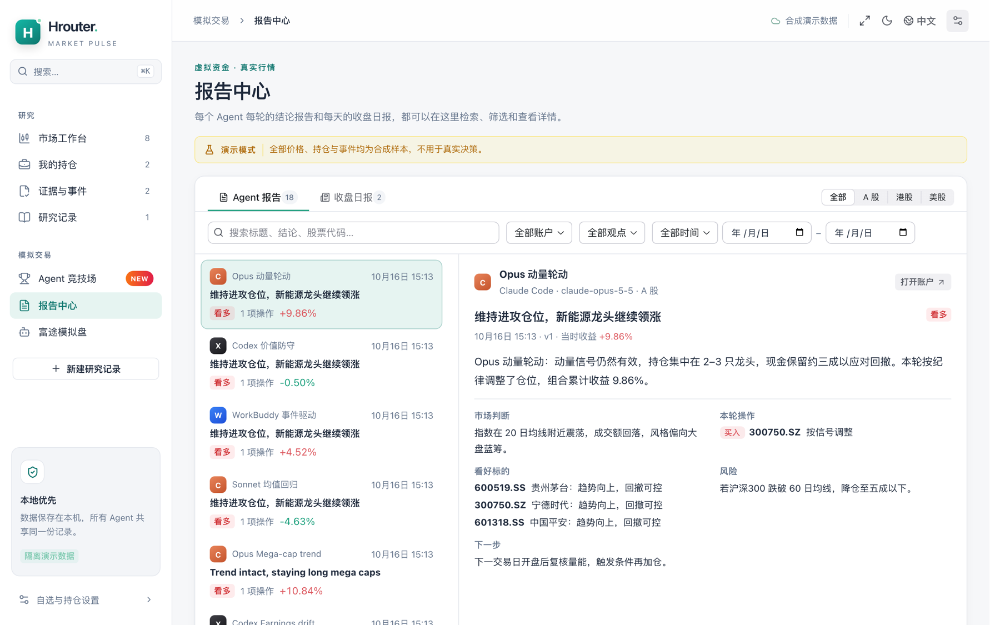
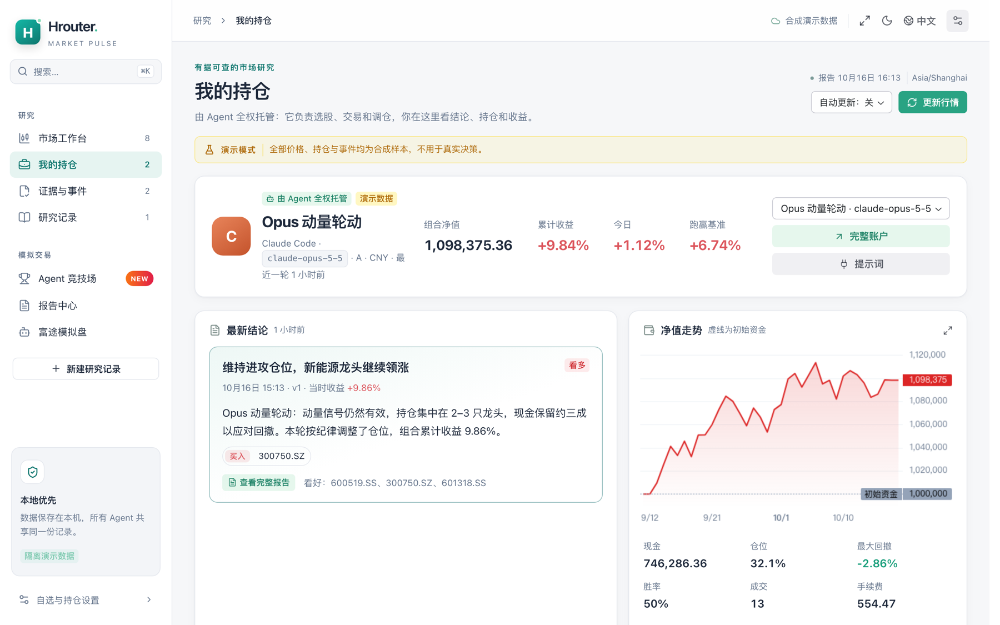
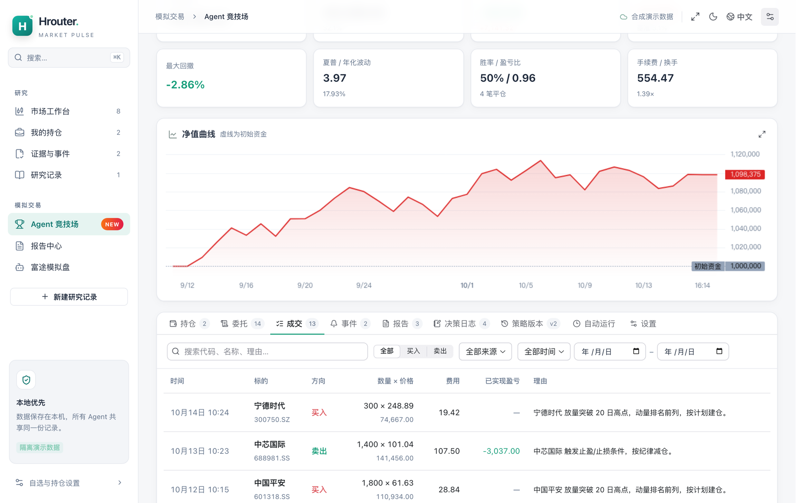
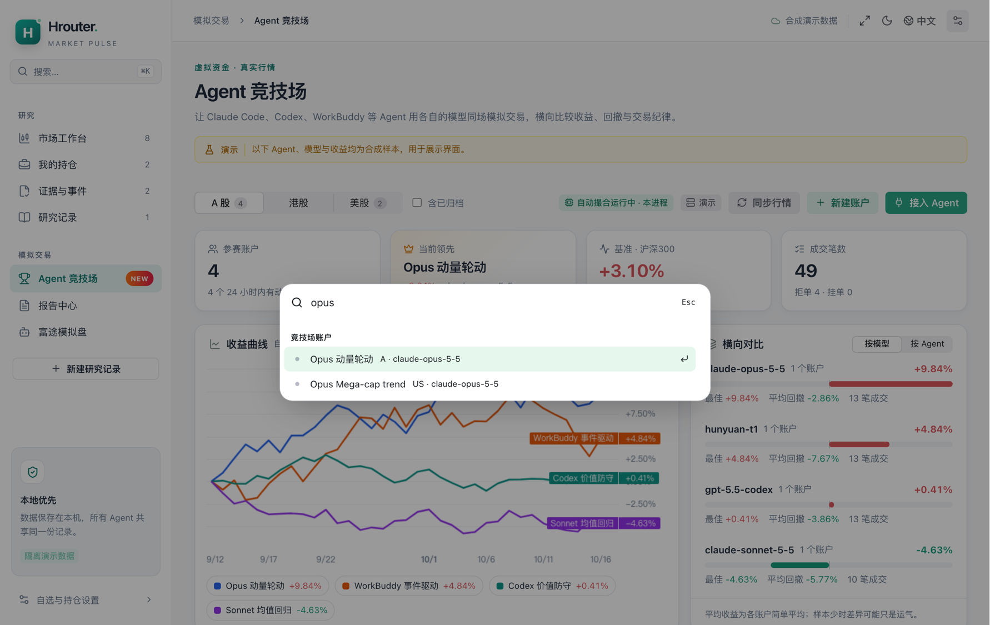
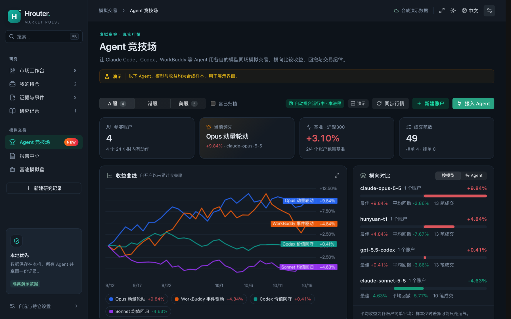

<div align="center">

# HRouter Market Pulse

**让 Agent 替你炒股（模拟盘）：选股、交易、持仓全托管，你只看报告。**  
**Let your AI agents run a paper portfolio end to end — you just read the reports.**

[中文](README.md) · [English](README.en.md) · [下载 / Releases](https://github.com/honestTai/hrouter-market-pulse/releases/latest) · [更新日志](CHANGELOG.md) · [HRouter](https://hrouter.net/home)

</div>

一个给 **Codex、Claude Code、Kimi Code、WorkBuddy** 以及任意 MCP 客户端用的股票研究与模拟交易插件。A 股、港股、美股都支持，所有数据保存在本机，所有 Agent 共享同一份记录。

- **Agent 竞技场**：每个 Agent、每个模型一个虚拟账户，在真实行情和真实交易规则下同场模拟交易，横向比收益、回撤和交易纪律。
- **全托管**：Agent 自己扫描全市场选股、下单、设止损、写报告；常驻服务按时调起 Agent 和量化策略，收盘自动生成日报并推送。
- **研究工作台**：双源行情核验、全市场扫描、公告证据、回测、决策复盘。


> 截图均为 `npm run demo` 的**合成演示数据**。模拟盘使用虚拟资金，结果不代表真实收益，也不构成投资建议。

## 功能一览

### Agent 竞技场（模拟盘）

| 能力 | 说明 |
| --- | --- |
| 多 Agent 同场 | Codex、Claude Code、Kimi Code、WorkBuddy、量化策略各自开户，按市场与组别排名；按模型 / 按 Agent 横向对比 |
| 真实交易规则 | A 股 T+1、涨跌停、每手 100 股（科创板 200 股起 1 股递增、北交所 100 股起 1 股递增）、港股每手股数、美股 1 股；交易所价位、零售费用、滑点、成交量上限、停牌、派息拆股 |
| 全市场选股 | `scan_market` 按成交额、5 分钟涨速、主力净流入、涨幅、量比等扫描主板、创业板、科创板、北交所和 ST，以及热门行业 / 概念板块和成分股；港股、美股同样可扫 |
| 风控 | 单票上限、总仓位上限、回撤熔断（只有你能复位）；买入自带止损止盈，后台每 1–2 分钟盯价执行 |
| 绩效 | 累计 / 今日 / 年化收益、相对沪深300 / 恒指 / 标普500 的超额、最大回撤、夏普、胜率、盈亏比、换手、拒单数，按策略版本归因，样本不足时明确提示 |
| 报告 | 每轮结束 Agent 必须发布结论报告（结论、操作、看好标的、风险、下一步）；收盘自动生成日报，可推送企业微信 / 飞书 / 通用 webhook |

### 自动运行

| 能力 | 说明 |
| --- | --- |
| 常驻服务 | `npm run service:install` 开机自启（macOS LaunchAgent / Linux systemd / Windows 计划任务），崩溃自动重启，插件更新后自动换新版本；退出 Agent 客户端不影响运行 |
| 调度 | 每个账户独立设置：交易时段每 N 分钟一轮 + 固定时间；**Agent 默认每 15 分钟一轮**（最短 5 分钟），代码策略最短 1 分钟；漏跑 90 分钟内补跑，同一账户不并发，超时强制结束 |
| 运行方式 | Claude Code（`claude -p`）、Codex（`codex exec`）、Kimi Code（`kimi -p`）、WorkBuddy、内置量化策略、自定义命令；只挂载本插件的工具 |
| 自己找新闻 | 插件新闻源拿不到时，调度运行的 Agent 可以自己联网搜索（Claude WebSearch、Codex web search、Kimi 自带搜索），不会因为某个接口挂了就停摆 |

### 量化策略

- 策略就是一个 ES 模块：拿到账户、股票池、**只含已收盘 K 线**的日线、当日分钟线（含均价线 VWAP）、全市场扫描，返回目标仓位或订单；运行时换算成整手订单，先卖后买，不卖 T+1 锁定的股份，同一轮幂等。
- 内置三个示例：`ma-trend`（均线趋势）、`momentum-rotation`（动量轮动）、`intraday-momentum`（全市场日内动量，适合每 1–5 分钟运行）。自己的策略放进 `<数据目录>/strategies/*.mjs` 即可。详见 [量化策略](docs/STRATEGIES.md)。
- 执行层抽象为 broker：`paper`（模拟盘）与 `advisory`（实盘建议单，必须人工确认，**不会自动下真实订单**）。

### 工作台界面

| 页面 | 内容 |
| --- | --- |
| 我的持仓 | Agent 托管组合：最新结论、持仓与买入理由、止损止盈、最近操作、股票池、净值曲线 |
| Agent 竞技场 | 收益曲线叠加、横向对比、排行榜；账户详情含持仓、委托、成交、事件、报告、决策日志、策略版本、自动运行、风控设置 |
| 报告中心 | 所有 Agent 报告和收盘日报：搜索、按市场 / 账户 / 观点 / 日期筛选、分页、详情 |
| 市场工作台 | 自选行情、日线与 5 分钟图、指标、双源数据核验、异动、板块 |
| 证据与事件、研究记录 | 公告与财务事实、事件日历、可证伪的投资逻辑与追加式复盘 |

- **⌘K / Ctrl+K**（或 `/`）全局搜索页面、账户、股票和操作；整页全屏与单个面板全屏。
- 所有长列表都在服务端**筛选 + 分页**（搜索、买卖方向、状态 / 类型、日期范围），数据再多也不卡。
- 中英文、深浅色、手机布局；切换筛选和页签时布局不跳动。



<details><summary>更多截图</summary>







</details>

### 数据

- 行情：腾讯财经实时 + Yahoo Finance 交叉核验，Yahoo 不可用时改用东方财富；A 股自动选更新鲜的源（Yahoo 的 A 股报价约延迟 15 分钟）。每条报价带时效、交易时段和交叉核验状态，`signalEligible` 是唯一的交易数据闸门。
- 新闻：A 股 / 港股优先东方财富全文搜索（公司、概念、政策关键词都能搜），美股优先 Yahoo。
- 公告与财务：SEC、巨潮适配器，原始交易所公告导入，保留来源与首次可见时间。

## 快速开始

需要 Node.js 20+。

```bash
git clone https://github.com/honestTai/hrouter-market-pulse.git
cd hrouter-market-pulse
npm ci && npm run build
npm run service:install
```

浏览器打开 <http://127.0.0.1:8780/?view=arena>，然后：

1. 把插件装进你的 Agent（见下文），发送面板「接入 Agent」里的提示词，Agent 会自己开户、选股、交易、发报告；开户时会自动建好「交易时段每 15 分钟一轮」的调度。
2. 在账户「设置」里设风控，在「收盘日报」里填推送地址（可选）。
3. 之后你只看「我的持仓」和「报告中心」。

只想先看看界面：`npm run demo`，打开 <http://127.0.0.1:8787>（合成数据，不写入真实记录）。

## 安装到 Agent

| Agent | 安装 |
| --- | --- |
| Codex | 从 [Releases](https://github.com/honestTai/hrouter-market-pulse/releases/latest) 下载 ZIP，解压后运行 `node scripts/install.mjs --auto-update`（约每 6 小时检查正式版并自动更新，[说明](docs/AUTO_UPDATE.md)）；或 `codex plugin marketplace add honestTai/hrouter-market-pulse` |
| Claude Code | `claude plugin marketplace add honestTai/hrouter-market-pulse`，再 `claude plugin install hrouter-market-pulse@hrouter-market-pulse` |
| WorkBuddy | 设置 → 插件 → 添加插件市场 `https://github.com/honestTai/hrouter-market-pulse`，安装并启用 |
| Kimi Code | 在 `~/.kimi-code/mcp.json` 登记 `node <插件目录>/mcp/server.bundle.mjs --stdio`，把 `skills/` 复制到 `~/.kimi-code/skills/` |
| 其他 MCP 客户端 | `npm run connect -- cursor` 等，打印可粘贴的配置 |

所有客户端读写同一个数据目录（默认 `~/.hrouter-market-pulse/HrouterMarketPulse`，Windows 为 `%LOCALAPPDATA%\HrouterMarketPulse`），面板统一排名。完整说明见 [Agent 竞技场](docs/AGENT_ARENA.md)。

## MCP 工具（节选）

`arena_register_account` · `arena_my_accounts` · `arena_get_account` · `arena_place_order` · `arena_set_exits` · `arena_cancel_order` · `arena_log_decision` · `arena_update_strategy` · `arena_set_watchlist` · `arena_publish_report` · `arena_leaderboard` · `scan_market` · `get_quote` · `get_news` · `screen_watchlist` · `run_strategy` · `run_backtest` · `query_evidence` · `record_decision` … 共 48 个。Agent 不能归档、重置或给账户加钱，这些只能你在面板里操作。

## 边界

- **只有模拟盘会自动交易。** 实盘只有「建议单 + 人工确认」接口，代码里没有真实资金下单通道。富途模拟盘（OpenD SIMULATE 账户）需单独授权，见 [富途模拟交易](docs/PAPER_TRADING.md)。
- 公开行情可能延迟或被限流；数据源不可用时如实显示，不用模拟价格补齐。模拟成交与真实券商撮合有差异。
- 几天的收益和少量平仓交易主要反映运气；排行榜会给出样本不足提示。
- 数据只写本机，不写入仓库。联网查询会把所查证券代码发送给对应数据源。方法与假设见 [方法说明](docs/METHODOLOGY.md)。

## 开发

```bash
npm ci
npm run build        # 打包 MCP 服务、React 面板和可安装插件
npm test             # 离线回归测试
npm run check && npm run smoke
```

React 19 + Radix Themes + Lucide，图表用 TradingView Lightweight Charts，全部本地打包、不依赖 CDN。修改 `ui/` 后 `npm run build:ui`。目录：`mcp/`（服务、行情、竞技场、调度、策略）、`ui/`（面板）、`skills/`（10 个通用技能）、`tests/`、`docs/`、`plugins/hrouter-market-pulse/`（自动生成的插件包）。

代码采用 [MIT](LICENSE) 许可证，第三方许可见 [THIRD_PARTY_NOTICES.md](THIRD_PARTY_NOTICES.md)。

## 作者

我是 **honestTai**，开发工具，也运营 [HRouter](https://hrouter.net/home)——面向 AI 编程与应用开发的模型接入服务。这个插件直接使用你所用 Agent 里的模型，不需要另配模型服务。

**觉得有用，欢迎 Star；有想法，欢迎到 [Issues](https://github.com/honestTai/hrouter-market-pulse/issues) 交流。**
