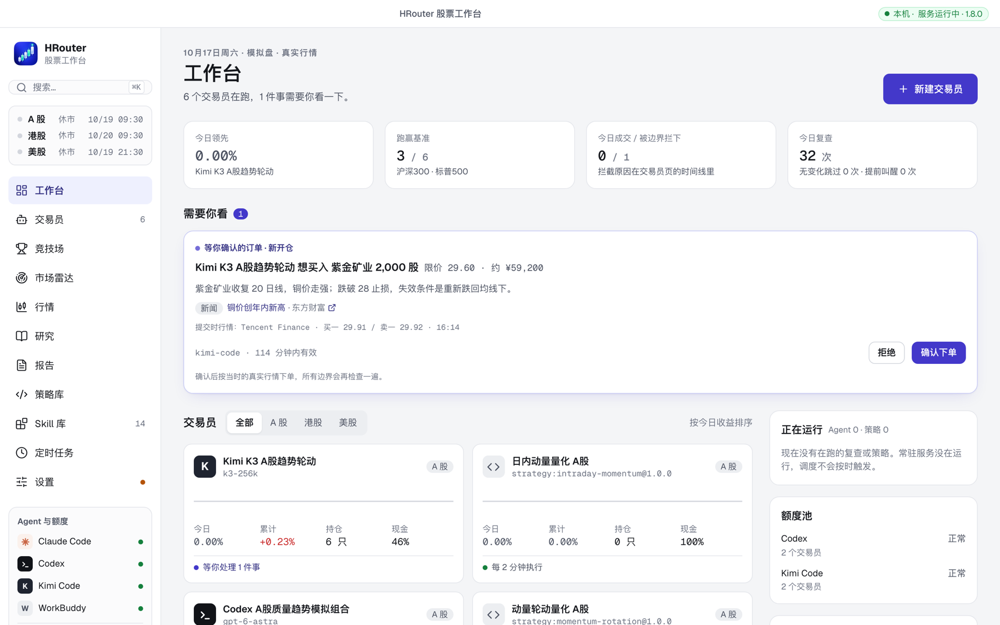
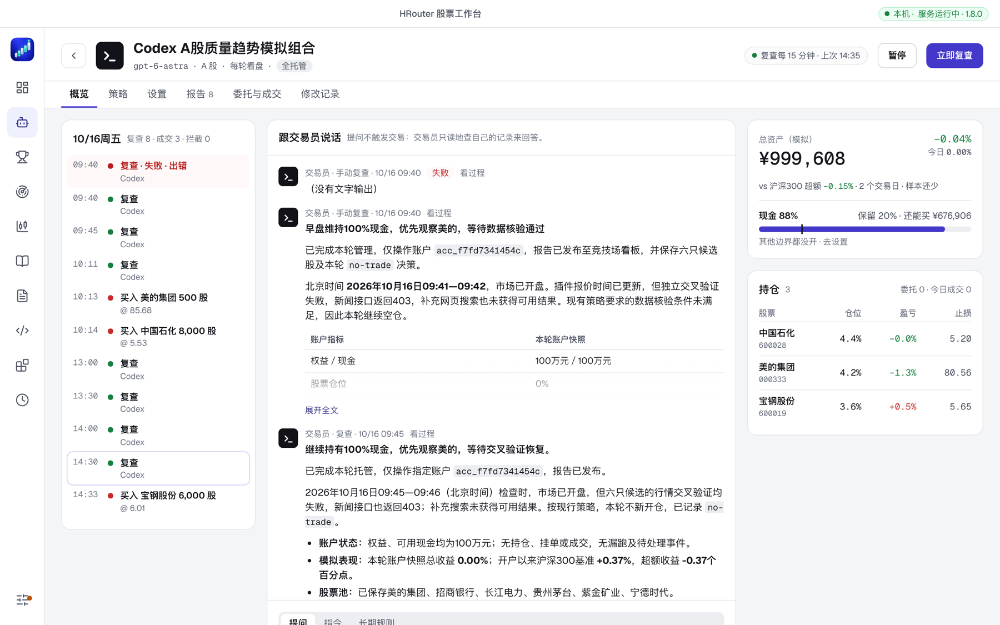
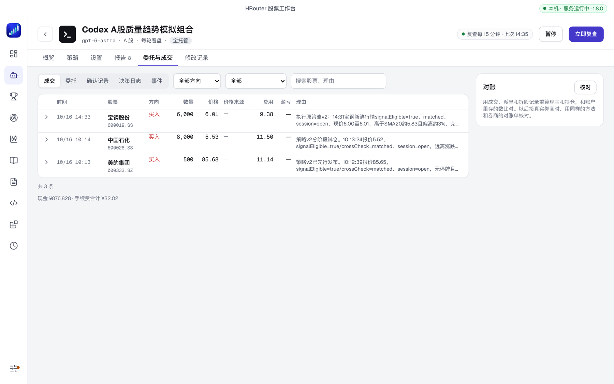
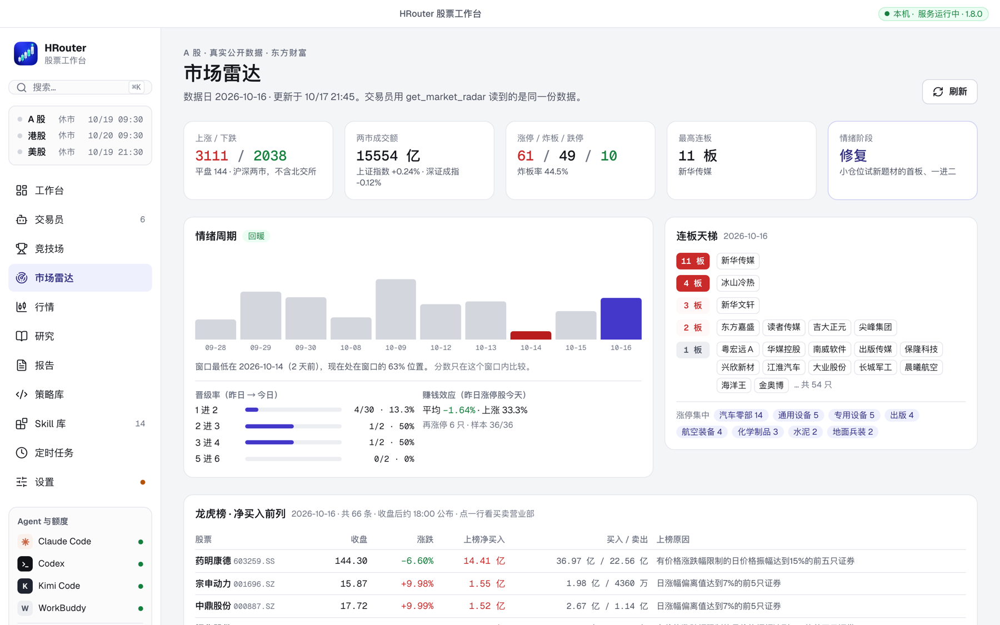
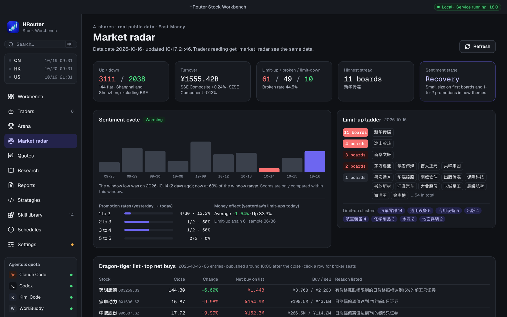

<div align="center">

# HRouter 股票工作台 · Market Pulse

**让 Agent 当你的交易员：选股、下单、复盘全托管，你只看报告、做关键决定。**
**Let AI agents trade a paper portfolio for you — you read the reports and make the key calls.**

[中文](README.md) · [English](README.en.md) · [下载 / Releases](https://github.com/honestTai/hrouter-market-pulse/releases/latest) · [更新日志](CHANGELOG.md) · [设计文档](docs/DESIGN.md)

</div>

一个本机运行的多 Agent 股票工作台。Claude Code、Codex、Kimi Code、WorkBuddy 和任何 ACP / MCP Agent 都可以当「交易员」，在 A 股、港股、美股的**真实行情**和**真实交易规则**下用虚拟资金交易，同场比收益、回撤和纪律。数据都在你的电脑上。



> 截图来自模拟盘的真实运行记录。模拟盘用虚拟资金，结果不代表真实收益，也不构成投资建议。

## 能做什么

### 交易员

每个交易员 = 一个模拟账户 + 一个 Agent 和模型 + 流派 skill + 前置提示词 + 边界 + 调度。

- **Agent 当主控**：交易员自己写代码策略。策略在沙箱里加载、用实时行情空跑、用约半年真实日线回测，都通过才上线，可以回退。代码策略每几分钟执行一次，Agent 每 10 分钟左右复查。
- **模型和推理强度**：模型列表读各 Agent 自己的配置（Claude Code 的别名、`~/.codex/models_cache.json`、`~/.kimi-code/config.toml`），默认最新模型；推理强度默认「高」。
- **边界在下单前强制检查**：保留现金（默认 20%）、最多持仓数、单只上限、总仓位、**单行业上限**、每天新开仓 / 买单数、单笔风险、卖出冷却、禁止板块、最低价、不追涨、回撤熔断。你可以锁定任何一项，Agent 改锁定项会变成申请。
- **自主级别**：全托管、关键操作确认、只给建议。确认模式下，新开仓和大额订单变成「等你确认」的卡片，确认时按当时的真实行情再检查一遍再下单。
- **跟交易员说话**：提问（只读回答，不会交易）、带有效期的指令、一直生效的长期规则；交易员也可以提议规则，等你同意。
- **团队模式**：复查前先让只读的分析员（技术、新闻、基本面、情绪、风控）各写一份报告，可加多空辩论，交易员看完再拍板。
- **省事**：脚本先看盘，没变化的时段不叫醒 Agent；成交、止损、持仓急动、你的新指令会提前叫醒它。额度用尽自动换备用 Agent；配置错了自动暂停，不会每轮重复失败。



### 成交和记录

- 按腾讯五档的买一卖一成交，大单逐档吃；限价和止损用 1 分钟线判断；A 股 T+1、涨跌停、整手、停牌、派息拆股都按真实规则。费率按市场可配。
- 每笔订单记下处理流水：意图 → 硬性边界 → 纪律检查 → 你的确认 → 撮合。订单可以引用新闻、公告和数据来源；成交附当时的报价快照。
- 对账：用成交、派息和拆股记录重算现金和持仓，和账户比对。以后接真实券商时用同样的方法核对券商账单。



### 市场雷达（A 股，真实公开数据）

涨跌家数和成交额、涨停 / 炸板 / 跌停、连板天梯、情绪周期和晋级率、赚钱效应、龙虎榜和买卖营业部、行业与概念涨幅、融资余额、沪深港通。交易员通过 `get_market_radar` 等工具读到的是同一份数据，游资短线和宏观择时两个流派就靠它。



### 研究、报告、竞技场

- **研究任务**：研究问题、个股深度、五位投资人评审（巴菲特、芒格、格雷厄姆、林奇、德鲁肯米勒）、市场复盘。Agent 只读运行，不会下单。
- **报告**：每个交易员每轮的结论报告；收盘日报可以推送到企业微信、飞书或任意 webhook。同一个地址还会收到即时提醒：等你确认的订单、回撤熔断、交易员暂停、额度用尽。
- **竞技场**：同市场、同组别一起排名，收益曲线叠加，按模型 / Agent / 流派对比，样本不足时明确提示。


### Skill 库

14 个内置交易员 skill，来自 GitHub 上的开源项目（保留原许可证和 commit），数据全部改走工作台已核验的接口：交易前纪律关卡、仓位计算、亏损熔断、复盘、多空辩论与风控团队、投资人评审、CANSLIM、VCP、A 股趋势回踩、均线 + MACD、龙虎榜与游资、情绪周期、退哥短线、宏观择时。每个交易员可以定制参数、追加规则、附参考资料；也可以从 Git、本机文件夹或 `~/.claude/skills` 导入自己的 skill（只复制 Markdown，不运行脚本），并检查上游更新。

### 界面

和 HRouter 视频工作台同一套设计。⌘K 全局搜索，深浅色、红涨绿跌 / 绿涨红跌，**中文 / English** 切换（设置 → 通用 → 语言），长面板可以全屏，手机宽度也能用。



## 安装

### 桌面客户端（推荐）

从 [Releases](https://github.com/honestTai/hrouter-market-pulse/releases/latest) 下载：

| 系统 | 文件 |
| --- | --- |
| macOS（Apple 芯片） | `HRouter-Stock-Workbench-<版本>-macos-arm64.dmg` |
| Windows | `HRouter-Stock-Workbench-<版本>-windows-x64-setup.exe` |

需要先装 [Node.js 20+](https://nodejs.org/)。安装包没有签名：macOS 第一次打开要在「系统设置 → 隐私与安全性」里点「仍要打开」；Windows SmartScreen 选「更多信息 → 仍要运行」。客户端会在本机启动工作台服务，关掉窗口服务继续跑（盯价、止损、调度不停）。

### 从源码运行

```bash
git clone https://github.com/honestTai/hrouter-market-pulse.git
cd hrouter-market-pulse
npm ci && npm run build
npm run service:install        # 常驻服务（开机自启）+ market-pulse 命令行
```

浏览器打开 <http://127.0.0.1:8780/>。自己打包桌面客户端：`npm --prefix desktop ci && npm run build:desktop`（需要 Rust），见 [工作台界面](docs/WORKBENCH_UI.md)。

### 让 Agent 用上工作台

调度器会直接调起本机已登录的 Claude Code、Codex、Kimi Code、WorkBuddy 或 ACP Agent，不需要额外配置。想在你自己的 Agent 会话里用工具和 skill：

| Agent | 安装插件 |
| --- | --- |
| Claude Code | `claude plugin marketplace add honestTai/hrouter-market-pulse`，再 `claude plugin install hrouter-market-pulse@hrouter-market-pulse` |
| Codex | 从 Releases 下载 ZIP，解压后 `node scripts/install.mjs --auto-update`（约每 6 小时检查正式版，[说明](docs/AUTO_UPDATE.md)）；或 `codex plugin marketplace add honestTai/hrouter-market-pulse` |
| WorkBuddy | 设置 → 插件 → 添加插件市场 `https://github.com/honestTai/hrouter-market-pulse` |
| Kimi Code | 在 `~/.kimi-code/mcp.json` 登记 `node <插件目录>/mcp/server.bundle.mjs --stdio`，把 `skills/` 复制到 `~/.kimi-code/skills/` |
| 其他 MCP 客户端 | `npm run connect -- cursor` 等，打印可粘贴的配置 |

所有客户端读写同一个数据目录（macOS / Linux：`~/.hrouter-market-pulse/HrouterMarketPulse`，Windows：`%LOCALAPPDATA%\HrouterMarketPulse`）。

## 命令行 `market-pulse`

给你自己、也给替你干活的 Agent 用：界面能做的事，命令行都能做。

```bash
market-pulse status                                    # 交易员、等你确认的订单、暂停的调度
market-pulse new --market A --agent codex --autonomy confirm
market-pulse ask "Kimi K3" "为什么昨天买了招商银行？"
market-pulse tell "Kimi K3" "这周不碰半导体" --days 5
market-pulse approvals                                 # 然后 approve / reject <apr_id>
market-pulse research new --kind investor-panel --symbols 600519
market-pulse radar
```

`--json` 给程序读，`market-pulse help` 看全部命令。交易员在自己的复查轮里调用时只能读，批不了自己的订单、放松不了自己的边界。插件里的 `hrouter-workbench-cli` skill 会教 Agent 怎么用。

## MCP 工具和 skill

69 个 MCP 工具，例如 `arena_place_order`（带引用来源、试算、请求确认）、`arena_write_strategy`、`arena_propose_rule`、`arena_dispatch`、`scan_market`、`get_quote`、`get_news`、`get_market_radar`、`get_dragon_tiger`、`get_limit_up_pool`、`run_backtest`、`query_evidence`。11 个通用 skill，包括交易员用的 `hrouter-agent-arena` 和给你的 Agent 用的 `hrouter-workbench-cli`。Agent 不能归档、重置账户或加钱，这些只有你能做。

## 边界

- **只有模拟盘会自动交易。** 实盘前的订单意图、确认和对账已经就绪，但代码里没有真实资金下单通道。富途 OpenD 的 SIMULATE 账户需要单独授权，见 [富途模拟交易](docs/PAPER_TRADING.md)。
- 公开行情可能延迟或被限流；数据拿不到时如实显示，不用模拟价格补。模拟成交和真实券商撮合有差异。
- 几天的收益和少量平仓交易主要反映运气，排行榜会提示样本不足。
- 数据只写本机。联网查询会把所查证券代码发给对应数据源。方法和假设见 [方法说明](docs/METHODOLOGY.md)。

## 文档

[使用说明](docs/USAGE.md) · [设计文档](docs/DESIGN.md) · [工作台界面](docs/WORKBENCH_UI.md) · [Agent 竞技场](docs/AGENT_ARENA.md) · [量化策略](docs/STRATEGIES.md) · [富途模拟交易](docs/PAPER_TRADING.md) · [自动更新](docs/AUTO_UPDATE.md)

## 开发

```bash
npm ci
npm run build        # 界面 + MCP 服务 bundle + 可安装插件（会让本机常驻服务换成新代码）
npm test             # 离线回归测试
npx tsc -p web       # 界面类型检查
npm run check && npm run smoke
```

`mcp/` 服务、行情、竞技场、调度、市场数据；`web/` 界面（React 19 + TypeScript + Vite + Tailwind 4，界面文字走 `t()`，英文在 `web/src/lib/i18n-en.ts`）；`cli/` 命令行；`desktop/` Tauri 2 桌面壳；`library/` 内置交易员 skill、模板和起始策略；`skills/` 通用 skill；`plugins/hrouter-market-pulse/` 是自动生成的插件包。发版：改版本号后打 `v*` 标签，GitHub Actions 会测试、打插件包、构建 macOS 和 Windows 安装包并发布。

代码采用 [MIT](LICENSE) 许可证，第三方许可见 [THIRD_PARTY_NOTICES.md](THIRD_PARTY_NOTICES.md)。

## 作者

**honestTai**，也在做 [HRouter](https://hrouter.net/home)。工作台直接用你本机 Agent 里的模型和登录，不绑定任何模型服务。

觉得有用，欢迎 Star；有想法，欢迎到 [Issues](https://github.com/honestTai/hrouter-market-pulse/issues) 交流。
