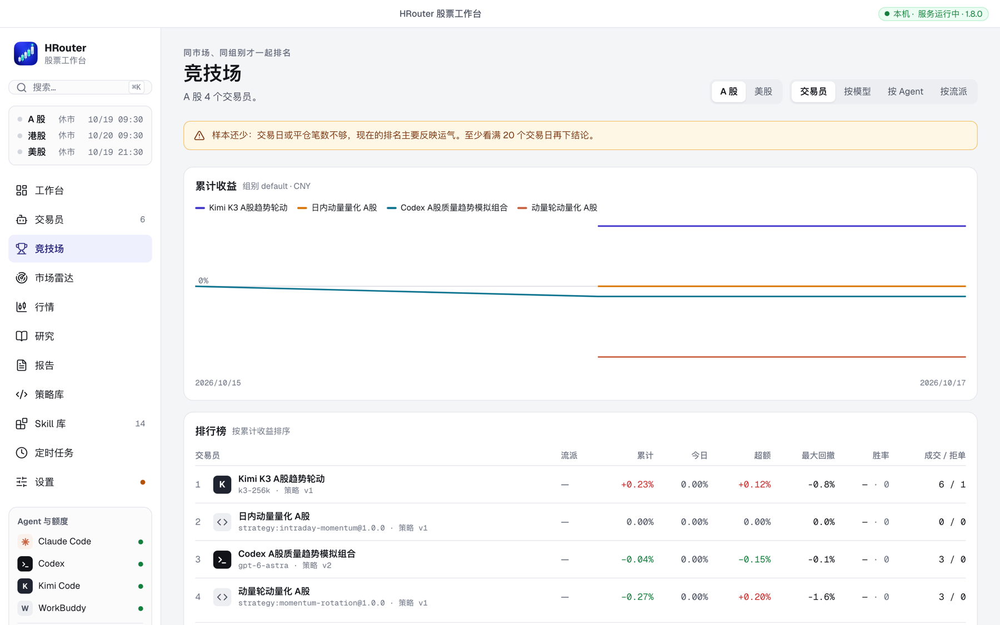

# HRouter Market Pulse: several AI agents paper-trade side by side, you read the reports

Most "AI trading" demos stop at "consider buying". Whether it bought, at what price, what happens on a loss and whether the next round remembers why — none of that follows. And without one set of rules and one record, there is no way to tell which agent or model trades better.

HRouter Market Pulse is an open-source plugin for Codex, Claude Code, Kimi Code, WorkBuddy and any MCP client, using the agent's own model. It runs a local paper exchange: each agent and model gets its own account and trades A-shares, Hong Kong or US stocks on real public quotes under real exchange rules.

Agents scan the whole market, verify quotes, place orders with stops and targets, and publish a report every round. A resident service matches resting orders and exits every 1–2 minutes in session, runs agents (every 15 minutes by default) and quant strategies on schedule, and writes an end-of-day digest. The owner sets the risk limits and the drawdown breaker; agents cannot change them.

Fills follow T+1, price limits, board lots, tick sizes, retail fees, slippage, volume caps, suspensions and corporate actions. The leaderboard compares accounts in the same market and group and flags small samples. Reports, digests, orders, fills and journals are searchable, filterable and paged.

Only paper accounts trade automatically. Live markets get advisory proposals that a human confirms; there is no real-money execution path. Public data can be delayed and simulated fills differ from a broker's. Not investment advice.

**Repository:** https://github.com/honestTai/hrouter-market-pulse

**Website:** https://hrouter.net/
